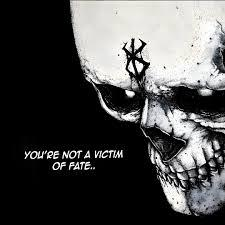

  

  

  
<b>📜 [ OPEN THE GRIMOIRE: Reveal Hidden Attributes ]</b>

  

     
    <code>[STATUS]: Corrupted</code> &nbsp;&bull;&nbsp; 
    <code>[MANA]: 999/999</code> &nbsp;&bull;&nbsp; 
    <code>[GUILD]: WebStorm & VS Code Sorcerers</code> 
    <i>"He who controls the architecture controls the fate of the realm. Every repository is a sealed dungeon waiting to be conquered."</i>
  

 

<!-- Master Layout Table -->
<table align="center" width="100%" style="border: 1px solid #4A0000; border-radius: 6px; background-color: #0d1117;">
  <!-- ROW 1: Lore and Skill Tree -->
  <tr>
    <td width="50%" valign="top" style="border-right: 1px solid #4A0000; border-bottom: 1px solid #4A0000;">
      <h3 align="center">🕳️ <b>[ ABYSSAL LORE ]</b></h3>
      
<em>"Kindling the bonfire while the grimoire compiles in the dark."</em>

      <ul>
        <li><b>Entity:</b> Rhapthorn</li>
        <li><b>Domain:</b> Full-Stack Development & IT Operations</li>
        <li><b>Relics of Choice:</b> TypeScript, React, Next.js, & Tauri</li>
        <li><b>Active Curses:</b> Architecting a Souls-like deckbuilder, forging modular bots, and constructing dashboards.</li>
        <li><b>Alignment:</b> Chaotic Neutral</li>
      </ul>
    </td>
    <td width="50%" valign="top" style="border-bottom: 1px solid #4A0000;">
      <h3 align="center">🗡️ <b>[ FORBIDDEN SKILL TREE ]</b></h3>
      

        
        
        
        
        
        
        
        
        
        
        
        
        
      

    </td>
  </tr>

  <!-- ROW 2: Artifact Mastery and Grimoire Metrics -->
  <tr>
    <td width="50%" valign="top" style="border-right: 1px solid #4A0000;">
      <h3 align="center">🩸 <b>[ ARTIFACT MASTERY ]</b></h3>
      <table align="center" width="100%" style="background-color: transparent; border: none;">
        <tr><td width="35%">🔥 TS & JS</td><td width="65%"></td></tr>
        <tr><td>🕸️ HTML & CSS</td><td></td></tr>
        <tr><td>🌌 React & Next</td><td></td></tr>
        <tr><td>⚙️ Node.js</td><td></td></tr>
        <tr><td>📜 Git</td><td></td></tr>
        <tr><td>🗄️ Database DB</td><td></td></tr>
        <tr><td>🕷️ Playwright</td><td></td></tr>
        <tr><td>⚡ Vite & Tauri</td><td></td></tr>
      </table>
    </td>
    <td width="50%" valign="top" align="center">
      <h3 align="center">📊 <b>[ GRIMOIRE METRICS ]</b></h3>
      

          
          
        
      

    </td>
  </tr>
</table>

 

  💀 <i>Summoned with dark magic & code &bull; Theme: Anime Dark Fantasy</i> 💀

